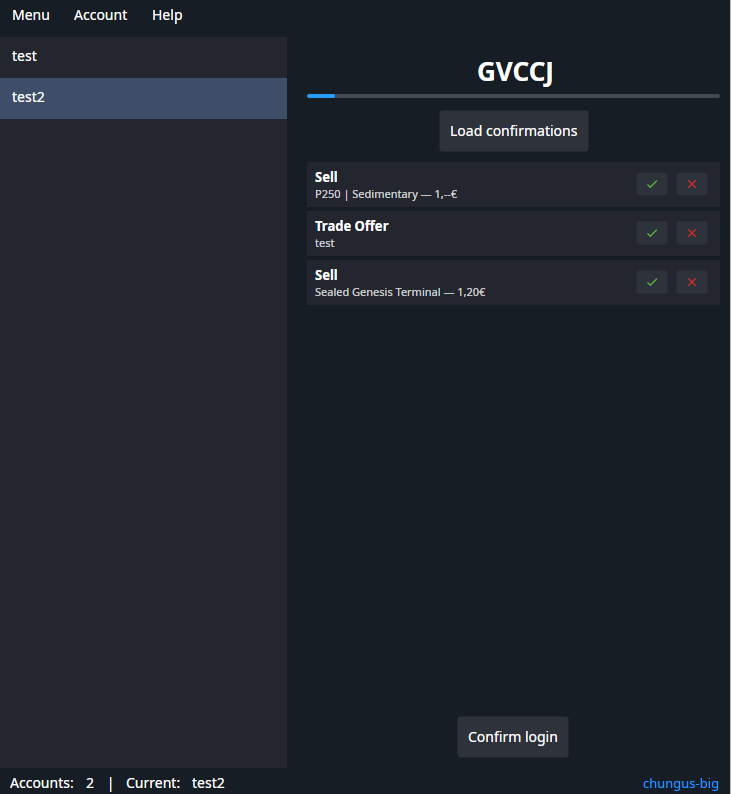

<div align="center">


# SDAnext

### Modern, Cross-Platform Steam Desktop Authenticator for Linux, Windows & macOS

[](https://dotnet.microsoft.com/)
[](https://avaloniaui.net/)
[](#supported-platforms)
[](LICENSE)
[](tests/SteamLib.Tests)

</div>

---

## 📖 Overview

**SDAnext** is a next-generation desktop authenticator for Steam, reimagined from the ground up as a high-performance, cross-platform successor to the classic Steam Desktop Authenticator (SDA).

Built on **.NET 8** and **Avalonia UI 12.1**, SDAnext delivers a native desktop experience on **Linux (Wayland & X11)**, **Windows**, and **macOS** with zero reliance on legacy Windows-only frameworks (WinForms, WPF). It provides complete compatibility with existing `.mafile` authenticators while introducing a modern asynchronous architecture, hardened memory security, and a fluid user interface.

---

## 📸 Preview

<div align="center">
  
</div>

---

## ✨ Key Features

- 🛡️ **Steam Guard TOTP Generator**
  - Instant 5-character Steam Guard code generation with custom Steam Base32 alphabet.
  - Automatic time alignment with Valve's official time servers (`ITwoFactorService/QueryTime`).
  - Hardware-accelerated circular progress indicator visualizing 30-second token expiration.

- 🔄 **Trade & Community Market Confirmations**
  - Live inspection of incoming/outgoing trade offers and Community Market sell/buy listings.
  - Real-time multi-language item name, icon, and price extraction.
  - One-click individual confirmation, rejection, and batch processing.
  - Option to display market listings separately or grouped by item type.

- 🧙 **7-Step Account Linker Wizard**
  - Bind Steam Guard 2FA to a new Steam account directly inside the app.
  - Step-by-step guidance: login, phone number association, SMS verification, revocation code generation, and safe `.mafile` generation.

- 📦 **4-Step maFile Mover Wizard**
  - Seamlessly migrate existing authenticators from physical mobile devices or other SDA installations without incurring Steam trade cooldowns.

- 🔒 **Ironclad Security & Encryption**
  - Optional local encryption of your `maFiles` with AES-256-CBC using PBKDF2 master password derivation.
  - In-memory credential protection: cryptographic keys are wiped after calculation using `CryptographicOperations.ZeroMemory`.
  - Sensitive tokens and secrets are automatically masked in logging and diagnostic outputs.

- 🌍 **Instant Dynamic Localization**
  - Switch between English and Russian on the fly with immediate UI updates—no application restarts required.

- ⚡ **High Performance & Low Resource Footprint**
  - Zero-allocation Protobuf handling backed by `ArrayPool<byte>.Shared`.
  - Compile-time Source-Generated JSON serializers (`SteamJsonSerializerContext`) and Regexes (`[GeneratedRegex]`).
  - Resilient network pipeline with exponential backoff, jitter, and automatic `Retry-After` (HTTP 429) rate-limiting management.

---

## 🖥️ Supported Platforms

| Platform | Architecture | Display Server / Environment | Status |
| :--- | :--- | :--- | :--- |
| **Linux** | `x64` | Native Wayland & X11 (glibc >= 2.16) | ✅ Fully Supported |
| **Windows** | `x64` | Windows 10, Windows 11 | ✅ Fully Supported |
| **macOS** | `x64`, `arm64` | macOS 12+ (Monterey, Ventura, Sonoma, Sequoia) | ✅ Fully Supported |

> [!NOTE]
> SDAnext can be compiled as a single-file, self-contained binary requiring no pre-installed .NET runtime on the host machine.

---

## 🚀 Getting Started

### Prerequisites
- **For running pre-compiled binaries:**
  - **Linux:** Standard desktop distribution with glibc >= 2.16 (Ubuntu 18.04+, Fedora 30+, Arch Linux, Debian 10+).
  - **Windows:** 64-bit Windows 10 or 11.
  - **macOS:** macOS 12.0 or newer.
- **For building from source:** [.NET 8.0 SDK](https://dotnet.microsoft.com/download/dotnet/8.0) or later.

---

## 🛠️ Building from Source

1. **Clone the repository:**
   ```bash
   git clone https://github.com/chungus-big/SDAnext.git
   cd SDAnext
   ```

2. **Run tests:**
   ```bash
   dotnet test
   ```
   *(All 86 unit and protocol regression tests run completely offline without contacting Steam servers).*

3. **Build the solution:**
   ```bash
   dotnet build -c Release
   ```

4. **Publish Single-File Executables:**

   - **Linux (x64):**
     ```bash
     dotnet publish src/NextAuth.Desktop/NextAuth.Desktop.csproj \
       -c Release -r linux-x64 --self-contained \
       -p:PublishSingleFile=true -o ./publish/linux
     ```

   - **Windows (x64):**
     ```bash
     dotnet publish src/NextAuth.Desktop/NextAuth.Desktop.csproj \
       -c Release -r win-x64 --self-contained \
       -p:PublishSingleFile=true -o ./publish/win
     ```

   - **macOS (x64 / Apple Silicon):**
     ```bash
     dotnet publish src/NextAuth.Desktop/NextAuth.Desktop.csproj \
       -c Release -r osx-x64 --self-contained \
       -p:PublishSingleFile=true -o ./publish/osx
     ```

---

## 📂 maFiles Compatibility

SDAnext offers **100% full compatibility** with existing Steam Desktop Authenticator files:

- **Directory Layout:**
  - `maFiles/` — Active encrypted or unencrypted authenticator files.
  - `maFiles_backup/` — Automatic backups generated during migration and export.
  - `maFiles_removed/` — Safely archived authenticators when removing accounts.
- **Format Support:**
  - Seamlessly reads legacy SDA `v1` `.mafile` files, modern `v2`/`v3` schemas, and minified formats.
  - Unknown properties and custom user tags are safely preserved during imports and exports through non-destructive serialization.

---

## 🔐 Privacy & Security

- **Direct Communication:** SDAnext connects **exclusively** to official Valve / Steam servers (`api.steampowered.com`, `steamcommunity.com`, `store.steampowered.com`).
- **Zero Telemetry:** No analytics, trackers, external pingbacks, or third-party API dependencies.
- **Local Storage Only:** Your account credentials, secrets, and session tokens remain on your local machine at all times.
- **Master Password:** Protect all your accounts with robust AES-256-CBC encryption.

---

## 📜 License & Credits

- **Project License:** Licensed under the [GNU Affero General Public License v3.0 (AGPL-3.0)](LICENSE).
- **Third-Party Notices:** For third-party components and license texts, see [LICENSES.md](LICENSES.md).
- **Acknowledgements:**
  - Based on and inspired by [NebulaAuth](https://github.com/achiez/NebulaAuth).
  - Built with [Avalonia UI](https://avaloniaui.net/), [CommunityToolkit.Mvvm](https://github.com/CommunityToolkit/dotnet), [protobuf-net](https://github.com/protobuf-net/protobuf-net).
